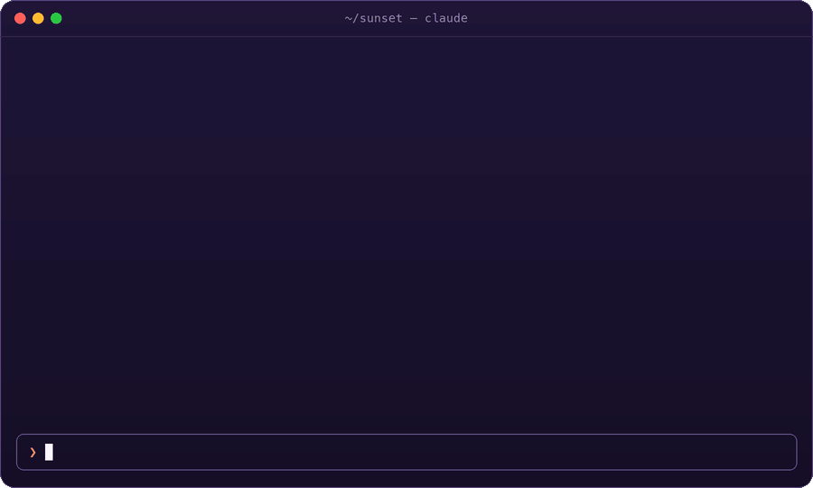
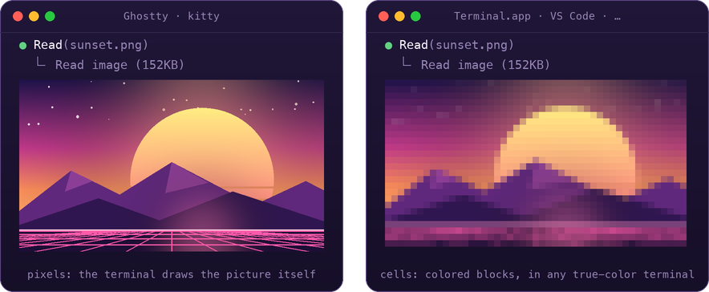

<p align="center">
  
</p>

<h1 align="center">Inline Images</h1>

<p align="center">
  <strong>See pictures right in the Claude Code terminal, as the desktop app shows them.</strong><br>
  What Claude reads, what you paste, what its answers show or name. GIFs play.
</p>

<p align="center">
  <a href="https://github.com/diegomarty/inline-images/actions/workflows/ci.yml"></a>
  <a href="https://github.com/diegomarty/inline-images/actions/workflows/latest-claude-code.yml"></a>
  
  
  
  
  <a href="LICENSE"></a>
</p>

<p align="center">
  <code>/plugin marketplace add diegomarty/inline-images</code> · <code>/plugin install inline-images@inline-images</code>
</p>

<p align="center">
  
</p>

---

A Claude Code mod: see pictures in the transcript, as the desktop app shows them. The images Claude reads, the ones you paste and the ones its answers embed or name are drawn under their rows; GIFs play. Or, in the compact view, each is a chip with its name that opens the picture by the pointer.

- **What Claude reads**: a `Read` of a PNG, JPEG, WebP or GIF shows the picture under its `⎿ Read image` line. A run of reads folded into one line (`Read 3 files`) shows each picture under it, named, and so does the same run unfolded (`--verbose`, or ctrl+o outside fullscreen).
- **What you paste**: while you write, the pictures pasted in the draft show in a strip above the prompt, small, side by side, each named `[Image #N]`; sent, the prompt shows them under it. Where the strip is narrow it draws the pictures that fit, each name whole, and counts the rest (`+3 more`).
- **What Claude embeds**: an answer with `` to a picture on this machine shows it under the paragraph that embeds it. Links to the web, and to files that are not there, draw nothing.
- **What Claude names**: an answer that mentions a picture (`docs/media/leads.gif`, or just `leads.gif`) shows it under the paragraph or list item that first names it. A name with no folder is looked for among the files under the working folder (`git ls-files`, ignored files left out); a name that matches no file draws nothing.
- **The compact view** (the **Compact view** option, off by default): every picture, read, pasted, embedded or named, is a chip with its name instead (`shot.png`, `[Image #1]`), an answer's beside the paragraph that first shows it. Put the pointer on a chip and the picture opens at full quality in the window by the pointer (below); move it off and the window closes. It needs the fullscreen interface and a window (not over ssh, nor on Linux with no display): elsewhere the pictures are drawn. A picture the window cannot show is drawn instead of its chip.

- **GIFs play** while they show on screen, each frame for its own delay; scrolled away, they stop on the frame they were on.
- **A click on a picture or a chip**, with the **Open on click** option on (it is off by default), opens it in the system's default viewer (`open` on macOS, `explorer` on Windows and under WSL, `xdg-open` on Linux): the file it was read from, or, for the bytes Claude was sent, the mod's copy of them. Clicks need the fullscreen interface.

## How it draws

| Terminal | In the transcript | Under the pointer |
| --- | --- | --- |
| Ghostty, kitty | The picture itself: the terminal draws it, through the kitty graphics protocol, reading the PNG (or each frame of a GIF) from a file | In the fullscreen interface, the picture larger, in a window of its own by the pointer |
| iTerm2 3.5 and later, in fullscreen | The picture itself, sent as its bytes, shrunk to 1024 pixels and 2 MB | The same |
| Any other (the VS Code terminal, Windows Terminal, Terminal.app, GNOME Terminal, Konsole, iTerm2 off fullscreen, tmux) | Colored cells, at half the rows | In the fullscreen interface, the picture at full quality, in a window of its own by the pointer |

Where the terminal draws cells, each is sampled at eight by eight points, in linear light, and drawn with the block that splits them best, in any terminal with true color, GIFs too. Cells are coarse: a screenshot of text shows its layout, not text you can read. So the pictures take half the rows there. In any terminal, a picture under the pointer (or its name over it, shown as a chip) opens larger, at full quality, in a small borderless window by the pointer, outside the terminal: above it and to its right, or where there is room, never over it. The window opens the moment the pointer comes, at the picture's size, a spinner in it, and the picture fills it once read: its program starts with the session, so there is no wait for it. It never takes the focus or the pointer, so you keep typing and hovering, and it closes as the pointer leaves. Each system draws it with what it has:

| System | The window | Needs |
| --- | --- | --- |
| macOS | An AppKit panel with the HUD material, run by `osascript` (JavaScript for Automation) | Nothing to install |
| Windows | A Windows Forms tool window, run by PowerShell | Nothing to install |
| WSL | The same Windows Forms window, run by `powershell.exe` from WSL | Nothing to install |
| Linux | A Tk tooltip window on X11 (a picture other than PNG or GIF converted to a PNG) | Python's Tk (`python3-tk` on Debian and Ubuntu) |

There is no window off the fullscreen interface (with no pointer to follow, as in iTerm2 or tmux outside it), over ssh (it would open on the other machine), on Linux without a display, or with the **Preview in a window** option off: there the transcript's drawing is all. A window's program that cannot show one sends the pictures back to the terminal for the rest of the session. The windows come from [Image Preview](https://github.com/midudev/better-claude/tree/main/plugins/image-preview)'s.

`CLAUDE_CODE_FORCE_TERMINAL_IMAGES=1` sends the bytes to a terminal Claude Code does not know draws pictures, shrunk to 1024 pixels and 2 MB.

### The VS Code extension, the desktop and mobile apps

The VS Code extension's panel and the desktop app draw what Claude reads and what you paste themselves; what they cannot draw is a picture from this machine's files. So there the mod draws the local pictures an answer embeds (``) or names (`docs/media/demo.gif`, or just `demo.gif`) under the answer, each named, side by side; the answer itself is drawn by the app, as ever. Each picture is an Svg holding it as a data URI: a PNG or GIF small enough goes as it is (a GIF keeps playing), any other is shrunk to a JPEG till it fits, drawn 480 points wide at most. Shrinking needs a converter (`sips` on macOS, PowerShell on Windows, ImageMagick on Linux).

<p align="center">
  
</p>

A picture takes as many cells as fit its shape, never much more than its own size, up to the **Picture height** option (`/config`, 12 rows by default) and 120 columns.

## /images

Turn the pictures off and on again for the session, or set their size, without going to `/config`:

| Command | |
| --- | --- |
| `/images` | Off if on, on if off |
| `/images off` · `/images on` | Every row draws as Claude Code's own; or with its pictures again |
| `/images small` · `medium` · `large` | Pictures up to 6 rows, the **Picture height** option's, or 24; and on |

It answers with how pictures are drawn now. A reload of the mod keeps what it set; a new session starts with pictures on, at medium.

## Options

| Option | Default | |
| --- | --- | --- |
| Picture height | 12 | The most terminal rows a picture takes. |
| Play GIFs | on | Off, a GIF shows its first frame. |
| Pictures in answers | on | Show the local pictures an answer embeds or names. |
| Preview in a window | on | A picture (or its name) under the pointer opens larger, at full quality, in a window by the pointer, in any terminal. Off, the transcript's drawing is all. |
| Compact view | off | Every picture is a chip with its name; the pointer on one opens the picture in the window by the pointer. |
| Open on click | off | A click on a picture or a chip opens it in the system's default viewer. |

## Install

```text
/plugin marketplace add diegomarty/inline-images
/plugin install inline-images@inline-images
```

The repository is private for now: adding it needs access to it, and git signed in to GitHub on the machine.

## Limits

- Images Claude reads are drawn from the file it read, at full quality, while it is still the file Claude read (as large as it was); once it is gone or has changed, from the bytes Claude was sent, which are smaller, so the row shows what Claude saw. A picture an answer embeds or names is looked at again every few seconds: changed, or written after the answer, it is drawn anew.
- Pictures up to 32 MB: one over 4 MiB is read in pieces (a PNG drawn by the terminal not at all: its header gives its size).
- A GIF is decoded by the mod itself (no ffmpeg): up to 300 frames, each shrunk to 480 pixels as it is decoded, and all of them to 48 MB together; a longer one is shrunk further. Only one frame is ever held at full size.
- PNG and GIF are decoded by the mod itself, with no converter, on every system. JPEG, WebP and the rest are converted, by the first of these the system has:

  | System | Converters, in order |
  | --- | --- |
  | macOS | `sips` (built in), ImageMagick |
  | Linux | ImageMagick (`magick`, or `convert` before version 7) |
  | Windows | ImageMagick, PowerShell's System.Drawing (built in) |
  | WSL | ImageMagick, Windows' PowerShell (built in) |

  Where none is there, such a picture says it needs one.
- On Windows the mod runs its file work through PowerShell, the paths handed over in the environment; under WSL with Linux's tools, and with Windows' PowerShell and viewer for what Linux there lacks.
- It reads pasted images from the folder Claude Code stores them in for the session (`<CLAUDE_CODE_TMPDIR or /tmp>/claude-<uid>/…/images`).
- tmux passes no pictures through: under it, the cells, even in Ghostty and kitty. Over ssh the terminal is on another machine and cannot read this one's files: Ghostty and kitty are sent the picture's bytes instead.
- Code is left as code: a `` inside a fence or a code span is not drawn.
- A picture that cannot be read says why once, and is not tried again on every redraw.
- What the mod keeps in memory (pictures read, their cells) stays within 112 MB together; past it the least recently shown go first, and are read again when next drawn. A picture on screen, or a GIF playing, never goes: with more on screen than fits, the budget is passed rather than a picture read again and again. A GIF that goes takes its frames off the disk too; the rest of the session's cache goes when the session ends.
- Its copies on disk (converted pictures, GIF frames) are in `<temp folder>/inline-images/<session id>`, removed when the session ends; a session's left behind (by a crash) goes a week later.
- In the compact view the pictures of an answer's chips are read as the answer draws (up to 8 an answer, of 2 MB or less), so the window has the picture's size as soon as the pointer comes onto the chip.
- The chips need the pointer, so Claude Code's fullscreen interface (`"tui": "fullscreen"` in your settings, or `/config`).
- To put each picture under (or its chip beside) the block that shows it, the mod draws such an answer itself, block by block, with the markdown renderer the engine draws replies with: an answer with no picture in it is the engine's as ever. Off fullscreen the engine draws it, the pictures under it.
- Hovering the name inside the answer itself cannot open the window: the mod is not told where each word of an answer lands once it wraps, so the chips stand beside its block.
- It covers what [Image Preview](https://github.com/midudev/better-claude/tree/main/plugins/image-preview) shows in a terminal that draws pictures (the draft's pictures, and the sent prompt's), drawn in place where Image Preview opens a card under the pointer: with this mod there is no need for that one. What it does not do is Image Preview's window of its own, at full quality, for a terminal that cannot draw pictures (Warp, iTerm2, Terminal.app, VS Code): there this mod draws cells. The two together have not been tried; both draw a strip above the prompt.

## How it works

One hooks module ([`hooks/register.tsx`](hooks/register.tsx)), a GIF decoder ([`hooks/gif.ts`](hooks/gif.ts)) and the cell painter ([`hooks/pixels.ts`](hooks/pixels.ts), from Image Preview):

- An `AbovePrompt` hook draws the draft's strip from a list of its `[Image #N]`, kept by `prompt.edit` (a key, a paste) and `prompt.change` (every other change of the box: a recalled entry, a submit or a clear, a plugin's fill).
- `ui.render` hooks on `ToolResult` and `ToolGroup` (Read calls whose output is an image), `UserMessage` (the `[Image #N]` of a sent prompt) and `AssistantMessage` (markdown images, and the pictures an answer names) draw the engine's row, then the pictures (or, in the compact view, chips) under it.
- On the VS Code extension, the desktop and mobile apps, which have no `Image`, an `AssistantMessage` hook draws the answer's local pictures under the app's own drawing of it, each an `Svg` with the picture inside as a data URI.
- Where the terminal draws cells, the session starts a window's program ([`hooks/window.ts`](hooks/window.ts)) with `$.process.spawn`, one for the session. The mod tells it what to show in a file (`$.fs.write`), which it reads every 40 milliseconds: a picture, with its size (the window opens with a spinner, then the picture fills it), or to hide the window, or to end. It says `ready`, `shown` for each picture, and a `.` every tenth of a second, so it ends when the session no longer reads it.
- Each chip is a `Client` ([`hooks/chip.tsx`](hooks/chip.tsx), as in Image Preview) that posts when the pointer comes onto it, leaves it and clicks it; a `ui.message` hook opens its picture in the window by the pointer, and closes it. Nothing is drawn in the transcript, so nothing moves under the pointer.
- Each picture is read once, in the background: a GIF is decoded into frames ([`hooks/gif.ts`](hooks/gif.ts)) and each written to a raw RGBA file; a PNG is drawn from its file, or decoded ([`hooks/png.ts`](hooks/png.ts), with its own inflate) to be drawn in cells or sent as pixels; any other picture from a PNG or BMP a converter writes. What it asks of the system (folders, bytes, conversions, the viewer) goes through [`hooks/system.ts`](hooks/system.ts), a way for each system. The rows that wait on it draw again.
- A GIF is a keyed `Image` (or `Raster`, in cells); `$.ui.blit` swaps its frame after each delay, with no redraw. A row reported off screen stops its animation.

## Development

To contribute, see [CONTRIBUTING.md](CONTRIBUTING.md): running the mod from a clone, checking a change, commits and pull requests.

```bash
claude plugin validate .   # the manifest, the marketplace and the hooks module
claude plugin test .       # runs hooks/register.test.tsx against the engine
claude --plugin-dir .      # a session with the mod loaded from this folder
```

GitHub Actions run the same checks: [CI](.github/workflows/ci.yml) on every push to `main` and every pull request, on the Claude Code version the plugin is built for; [Latest Claude Code](.github/workflows/latest-claude-code.yml) every Monday on the newest one, opening an issue when they fail (the mod API is early access); and [Release](.github/workflows/release.yml) on a `v<version>` tag that matches `plugin.json`, which makes the GitHub release. Dependabot keeps the actions up to date.

The icon, [`.claude-plugin/icon.png`](.claude-plugin/icon.png), and the illustrations in [`docs/`](docs) are drawn by scripts, from the same pieces ([`scripts/art.py`](scripts/art.py)); they need Pillow:

```bash
python3 scripts/make-icon.py .claude-plugin/icon.png
python3 scripts/make-readme-images.py docs
```

MIT © DiegoMarty. [`hooks/pixels.ts`](hooks/pixels.ts) and [`hooks/chip.tsx`](hooks/chip.tsx) come from [midudev/better-claude](https://github.com/midudev/better-claude), MIT © Miguel Ángel Durán (midudev).
