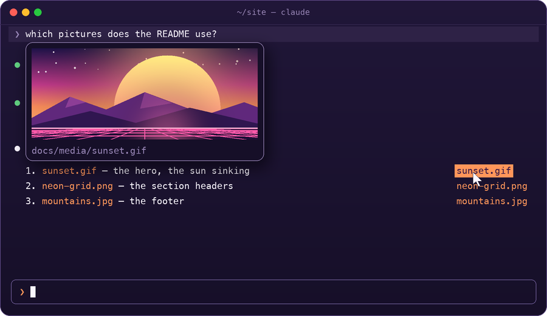

<p align="center">
  
</p>

<h1 align="center">Inline Images</h1>

<p align="center">
  <strong>See pictures right in the Claude Code terminal, as the desktop app shows them.</strong><br>
  What Claude reads, what you paste, what its answers show or name. GIFs play.
</p>

<p align="center">
  <a href="https://github.com/diegomarty/inline-images/actions/workflows/ci.yml"></a>
  <a href="https://github.com/diegomarty/inline-images/actions/workflows/latest-claude-code.yml"></a>
  
  
  
  
  <a href="LICENSE"></a>
</p>

<p align="center">
  <code>/plugin marketplace add diegomarty/inline-images</code> · <code>/plugin install inline-images@inline-images</code>
</p>

<p align="center">
  
</p>

---

A Claude Code mod: see pictures in the transcript, as the desktop app shows them. The images Claude reads, the ones you paste and the ones its answers embed are drawn under their rows; the ones an answer only names get a chip that shows the picture under the pointer; GIFs play.

- **What Claude reads**: a `Read` of a PNG, JPEG, WebP or GIF shows the picture under its `⎿ Read image` line. A run of reads folded into one line (`Read 3 files`) shows each picture under it, named, and so does the same run unfolded (`--verbose`, or ctrl+o outside fullscreen).
- **What you paste**: a prompt you sent with `[Image #N]` in it shows its pictures under it, side by side.
- **What Claude embeds**: an answer with `` to a picture on this machine shows it under the paragraph that embeds it. Links to the web, and to files that are not there, draw nothing.
- **What Claude names**: an answer that mentions a picture (`docs/media/leads.gif`, or just `leads.gif`) gets a chip beside the paragraph or list item that names it. Put the pointer on a chip and the picture opens in a card over the answer; move it off and the card closes; click it and the picture opens in the system's viewer. A name with no folder is looked for among the files under the working folder (`git ls-files`, ignored files left out); a name that matches no file gets no chip.

<p align="center">
  
</p>

- **GIFs play** while they show on screen, each frame for its own delay; scrolled away, they stop on the frame they were on.
- **A click on a picture** opens it in the system's viewer (Preview on macOS): the file it was read from, or, for the bytes Claude was sent, the mod's copy of them. Clicks need the fullscreen interface.

## How it draws

In Ghostty and kitty the terminal draws the picture itself, through the kitty graphics protocol: it reads the PNG, or each frame of a GIF, from a file, so no picture crosses Claude Code. `CLAUDE_CODE_FORCE_TERMINAL_IMAGES=1` sends the bytes to a terminal Claude Code does not know draws pictures (iTerm2 3.5 and later, under fullscreen rendering), shrunk to 1024 pixels and 2 MB. Elsewhere the picture is drawn in colored block elements, GIFs too: each cell sampled at eight by eight points, in linear light, in any terminal with true color. Cells are coarse: a screenshot of text shows its layout, not text you can read.

<p align="center">
  
</p>

A picture takes as many cells as fit its shape, never much more than its own size, up to the **Picture height** option (`/config`, 12 rows by default) and 120 columns.

## Options

| Option | Default | |
| --- | --- | --- |
| Picture height | 12 | The most terminal rows a picture takes. |
| Play GIFs | on | Off, a GIF shows its first frame. |
| Pictures in answers | on | Show the local pictures an answer embeds, and a chip for each one it names. |

## Install

```text
/plugin marketplace add diegomarty/inline-images
/plugin install inline-images@inline-images
```

The repository is private for now: adding it needs access to it, and git signed in to GitHub on the machine.

## Limits

- Images Claude reads are drawn from the file it read, at full quality, while it is still the file Claude read (as large as it was); once it is gone or has changed, from the bytes Claude was sent, which are smaller, so the row shows what Claude saw. A picture an answer embeds or names is looked at again every few seconds: changed, or written after the answer, it is drawn anew.
- Pictures up to 32 MB: one over 4 MiB is read in pieces (a PNG drawn by the terminal not at all: its header gives its size).
- A GIF is decoded by the mod itself (no ffmpeg): up to 300 frames, each shrunk to 480 pixels as it is decoded, and all of them to 48 MB together; a longer one is shrunk further. Only one frame is ever held at full size.
- Other formats are converted with `sips` on macOS and ImageMagick (`magick` or `convert`) elsewhere. Without them, a PNG still shows in Ghostty and kitty and a GIF everywhere; the rest say they need a converter.
- It reads pasted images from the folder Claude Code stores them in for the session (`<CLAUDE_CODE_TMPDIR or /tmp>/claude-<uid>/…/images`).
- tmux passes no pictures through: under it, the cells, even in Ghostty and kitty. Over ssh the terminal is on another machine and cannot read this one's files: Ghostty and kitty are sent the picture's bytes instead.
- Code is left as code: a `` inside a fence or a code span is not drawn.
- A picture that cannot be read says why once, and is not tried again on every redraw.
- What the mod keeps in memory (pictures read, their cells) stays within 112 MB together; past it the least recently shown go first, a GIF playing last, and are read again when next drawn.
- Its copies on disk (converted pictures, GIF frames) are in `<temp folder>/inline-images/<session id>`, removed when the session ends; a session's left behind (by a crash) goes a week later.
- The pictures a chip names are read as the answer draws (up to 8 an answer, of 2 MB or less), so the card has its picture as soon as the pointer comes onto the chip.
- The chips need the pointer, so Claude Code's fullscreen interface (`"tui": "fullscreen"` in your settings, or `/config`). The card opens over the rows above the chip's block, or below it where the rows above are too few, up to 24 for the picture.
- To put the chips beside their blocks, the mod draws such an answer itself, block by block, with the markdown renderer the engine draws replies with: an answer with no picture in it is the engine's as ever. Off fullscreen the engine draws it, the embedded pictures under it.
- Hovering the name inside the answer itself cannot open the card: the mod is not told where each word of an answer lands once it wraps, so the chips stand beside its block.
- Beside [Image Preview](https://github.com/midudev/better-claude/tree/main/plugins/image-preview), the pasted pictures show under the prompt and hovering an `[Image #N]` is meant to still open its card; the two together have not been tried yet.

## How it works

One hooks module ([`hooks/register.tsx`](hooks/register.tsx)), a GIF decoder ([`hooks/gif.ts`](hooks/gif.ts)) and the cell painter ([`hooks/pixels.ts`](hooks/pixels.ts), from Image Preview):

- `ui.render` hooks on `ToolResult` and `ToolGroup` (Read calls whose output is an image), `UserMessage` (the `[Image #N]` of a sent prompt) and `AssistantMessage` (markdown images, and the pictures an answer names) draw the engine's row, then the pictures or chips under it.
- Each chip is a `Client` ([`hooks/chip.tsx`](hooks/chip.tsx), as in Image Preview) that posts when the pointer comes onto it, leaves it and clicks it; a `ui.message` hook keeps which chip has the pointer, and the answer draws the card last, `position: "absolute"`, over the rows above the chip's block (or below it, where the rows above are too few), so nothing moves under the pointer and no block paints over it. Where each block is comes from a probe in it ([`hooks/probe.tsx`](hooks/probe.tsx)), an unpainted `Client` as tall as its block, that says how many rows it was laid out in.
- Each picture is read once, in the background: a GIF is decoded into frames and each written to a raw RGBA file; another picture is drawn from its PNG, or a PNG `sips` or ImageMagick writes. The rows that wait on it draw again.
- A GIF is a keyed `Image` (or `Raster`, in cells); `$.ui.blit` swaps its frame after each delay, with no redraw. A row reported off screen stops its animation.

## Development

```bash
claude plugin validate .   # the manifest, the marketplace and the hooks module
claude plugin test .       # runs hooks/register.test.tsx against the engine
claude --plugin-dir .      # a session with the mod loaded from this folder
```

GitHub Actions run the same checks: [CI](.github/workflows/ci.yml) on every push to `main` and every pull request, on the Claude Code version the plugin is built for; [Latest Claude Code](.github/workflows/latest-claude-code.yml) every Monday on the newest one, opening an issue when they fail (the mod API is early access); and [Release](.github/workflows/release.yml) on a `v<version>` tag that matches `plugin.json`, which makes the GitHub release. Dependabot keeps the actions up to date.

The icon, [`.claude-plugin/icon.png`](.claude-plugin/icon.png), and the illustrations in [`docs/`](docs) are drawn by scripts, from the same pieces ([`scripts/art.py`](scripts/art.py)); they need Pillow:

```bash
python3 scripts/make-icon.py .claude-plugin/icon.png
python3 scripts/make-readme-images.py docs
```

MIT © DiegoMarty. [`hooks/pixels.ts`](hooks/pixels.ts) and [`hooks/chip.tsx`](hooks/chip.tsx) come from [midudev/better-claude](https://github.com/midudev/better-claude), MIT © Miguel Ángel Durán (midudev).
